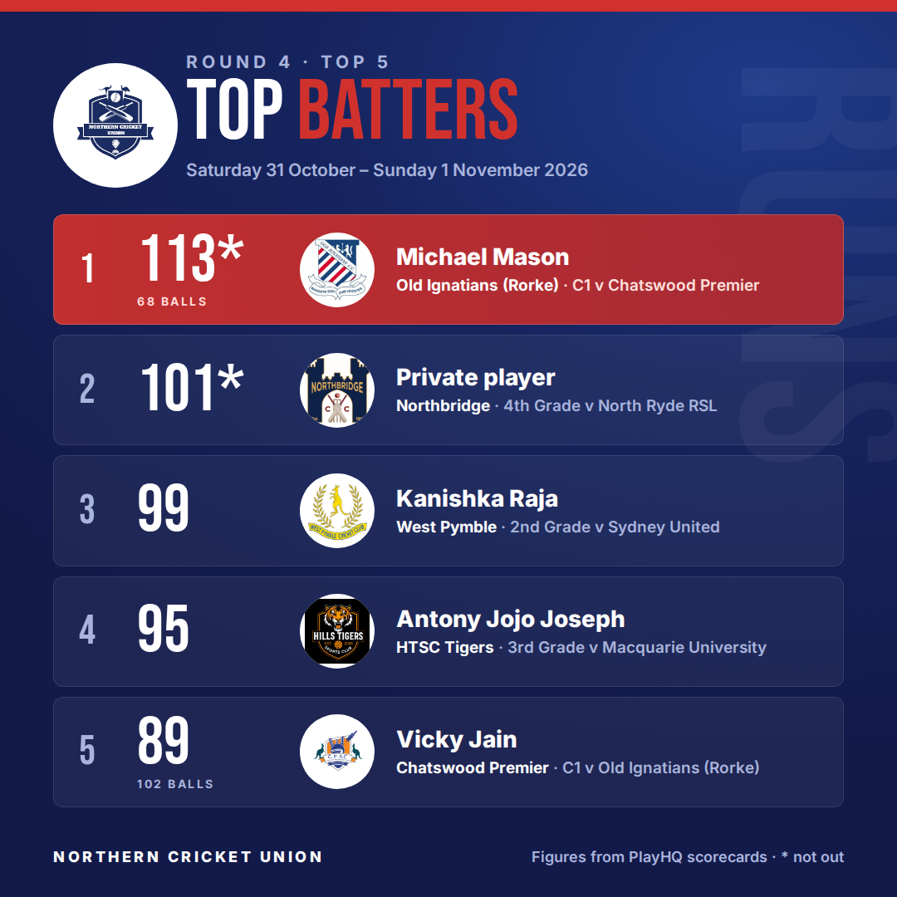
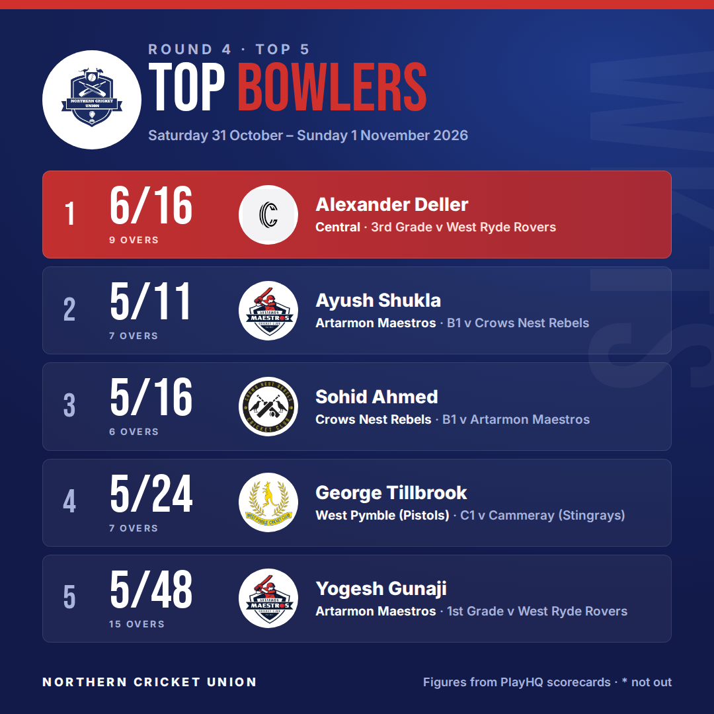
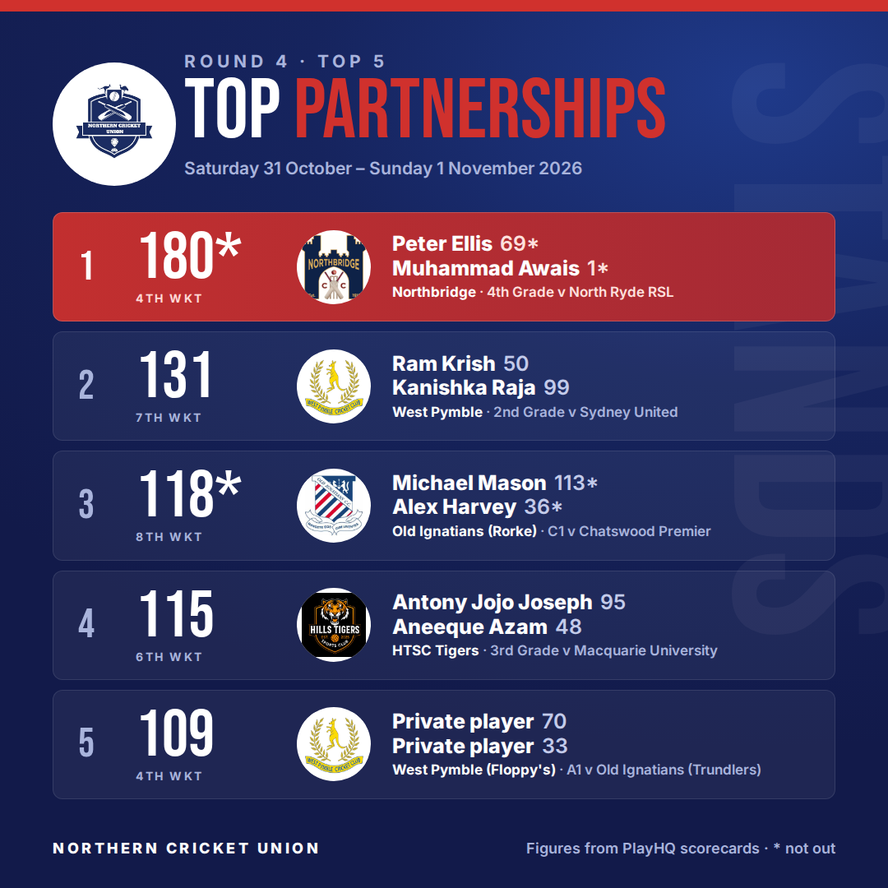
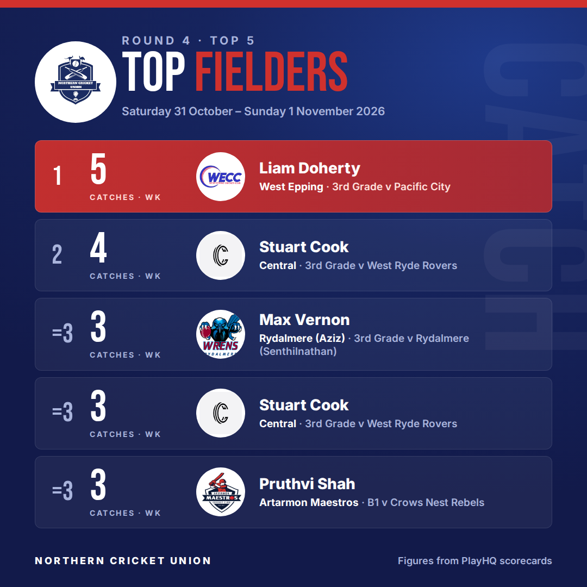

<!-- top5:dir=rounds/summer-2026-27/round-4 -->
**Round 4 Top 5** — Saturday 31 October – Sunday 1 November 2026. 23 scorecards read.

To post: check the cards and the caption, edit the caption below if you want to (keep the two marker lines), then add the **approved** label. The cards go up as one album on the NCU Page and the link is added here.

### Check before posting
- Carlingford Waratah (2nd Grade v Northbridge) — partnership pairs may be wrong: 2136ce30-a57a-4cfa-bc9a-a0369ee1b39d
- Carlingford Waratah (4th Grade v Kirribilli) — partnership pairs may be wrong: 3cdf2b15-3965-4c2b-b57d-271c0d9c3987
- batting: a private player (Northbridge, 101*) is shown as "Private player"
- partnerships: a private player (West Pymble (Floppy's), 109) is shown as "Private player"

### Caption
<!-- caption:start -->
🏏 Round 4 Top 5s are in!

🔥 Top score: Michael Mason 113* (Old Ignatians (Rorke) C1)
🎯 Best bowling: Alexander Deller 6/16 (Central 3rd Grade)
🤝 Biggest stand: Peter Ellis & Muhammad Awais, 180 for the 4th wicket (Northbridge 4th Grade)
🧤 Safe hands: Liam Doherty with 5 catches

Swipe through for the full Top 5 batting, bowling, partnerships and fielding 👉

Figures from PlayHQ scorecards. Spotted something we missed? Let us know in the comments.

#NCUcricket #grassrootscricket
<!-- caption:end -->

### Cards

