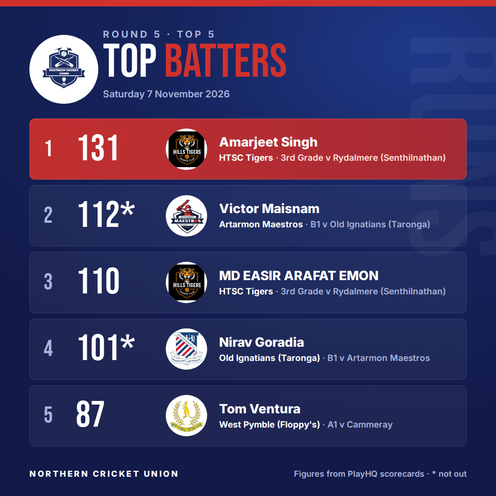
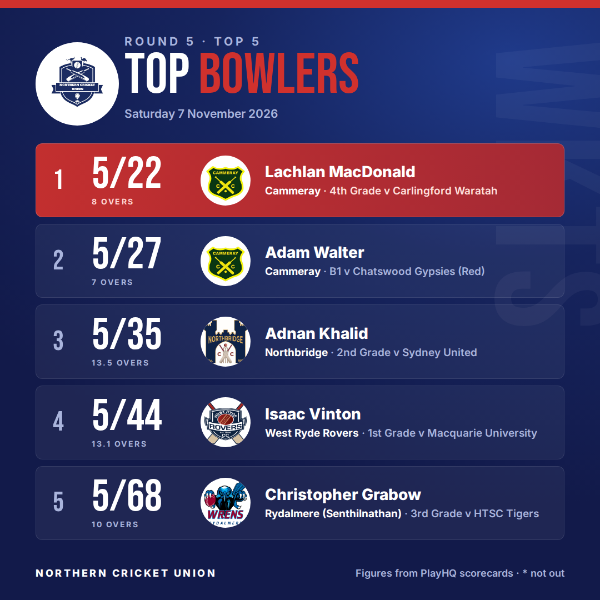
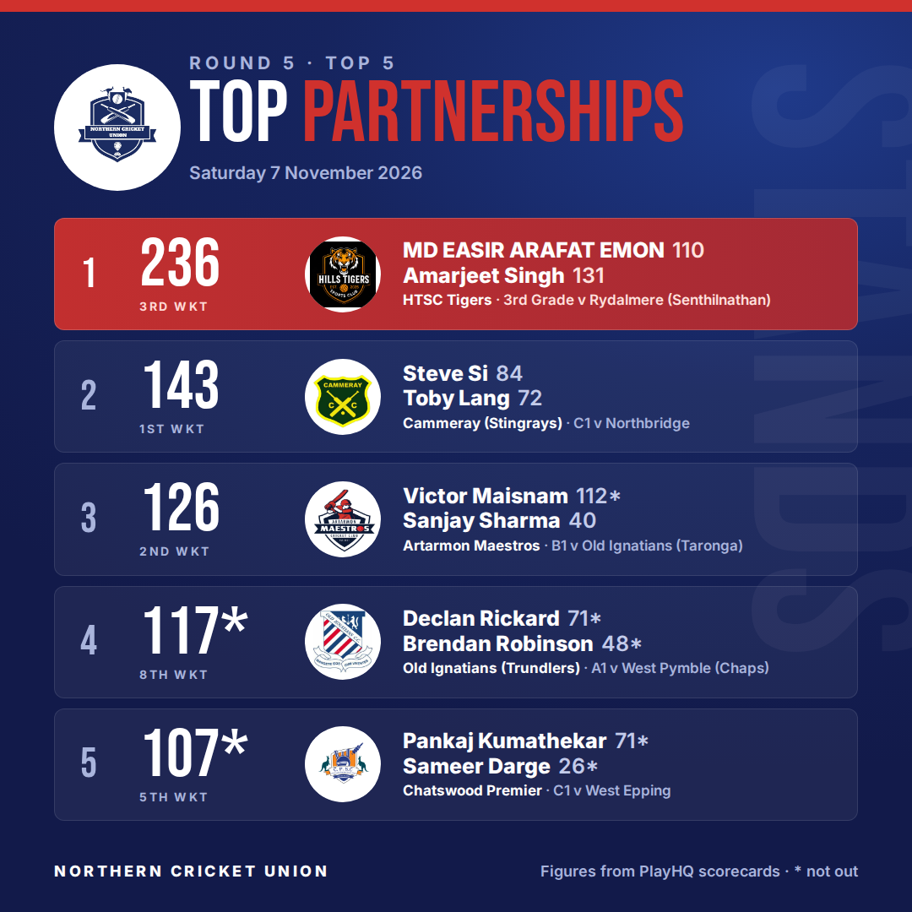
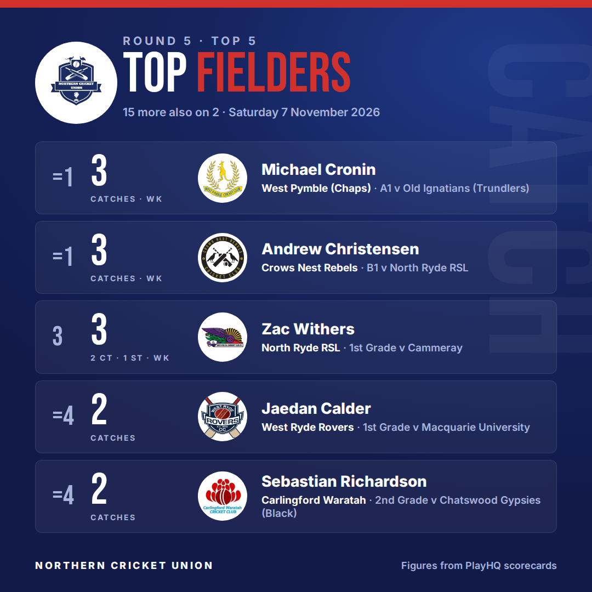

<!-- top5:dir=rounds/summer-2026-27/round-5 -->
**Round 5 Top 5** — Saturday 7 November 2026. 16 scorecards read; 11 two-day innings still going at stumps wait for next week.

To post: check the cards and the caption, edit the caption below if you want to (keep the two marker lines), then add the **approved** label. The cards go up as one album on the NCU Page and the link is added here.

### Caption
<!-- caption:start -->
🏏 Round 5 Top 5s are in!

🔥 Top score: Amarjeet Singh 131 (HTSC Tigers 3rd Grade)
🎯 Best bowling: Lachlan MacDonald 5/22 (Cammeray 4th Grade)
🤝 Biggest stand: MD EASIR ARAFAT EMON & Amarjeet Singh, 236 for the 3rd wicket (HTSC Tigers 3rd Grade)
🧤 Safe hands: Michael Cronin and Andrew Christensen with 3 catches each

Swipe through for the full Top 5 batting, bowling, partnerships and fielding 👉

Figures from PlayHQ scorecards. Spotted something we missed? Let us know in the comments.

#NCUcricket #grassrootscricket
<!-- caption:end -->

### Cards

