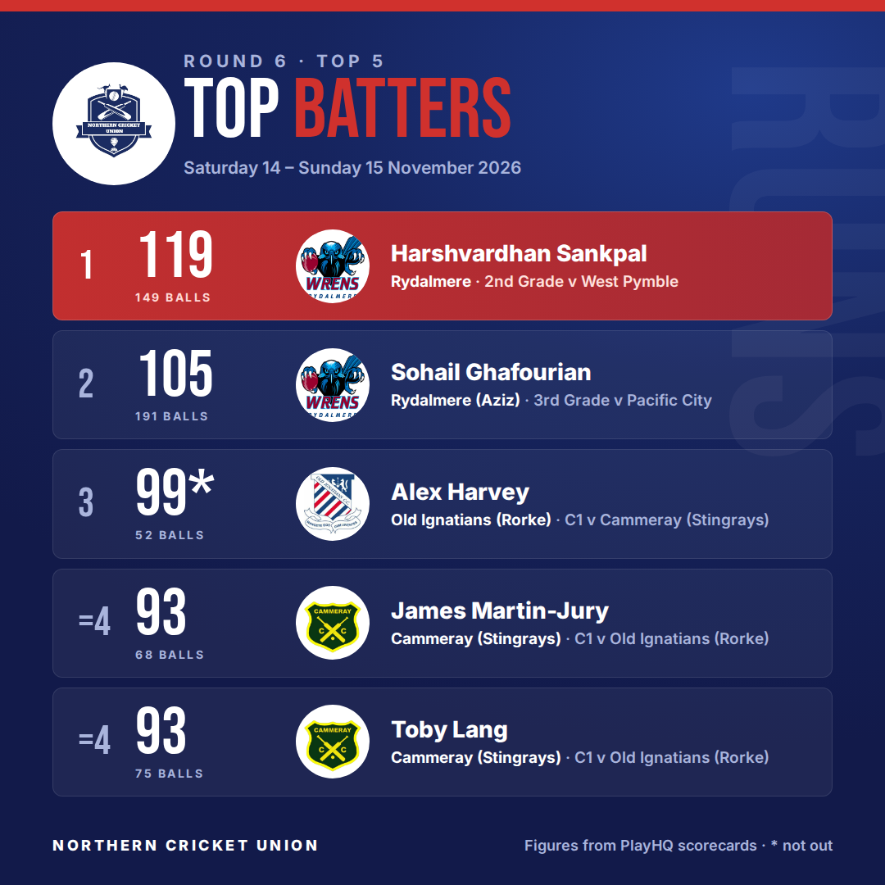
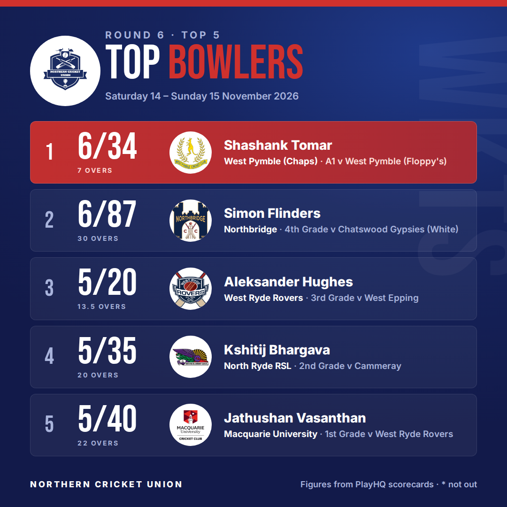
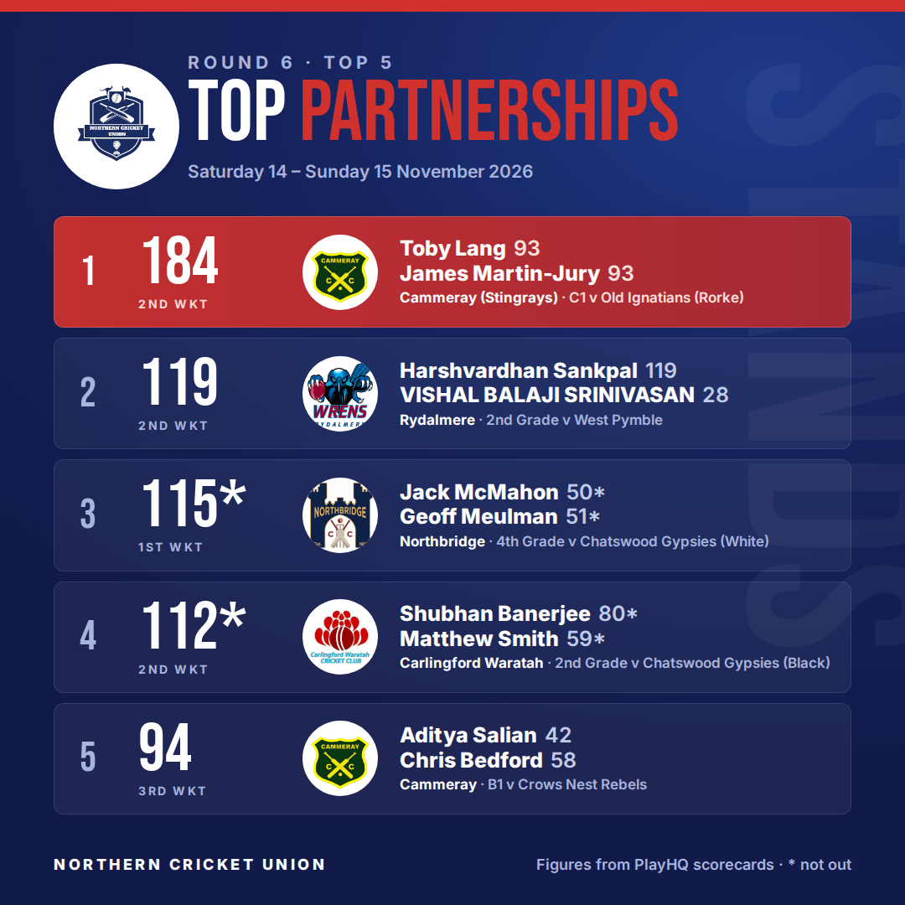
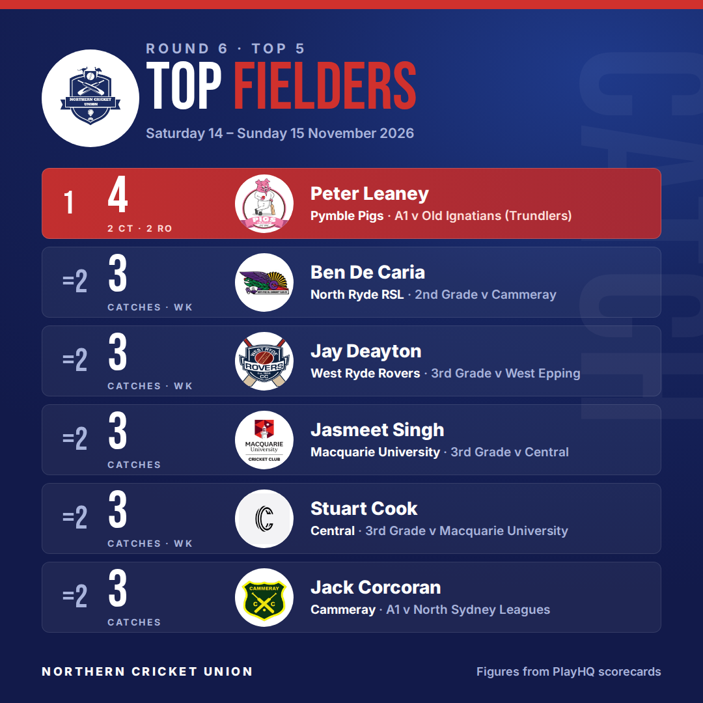

<!-- top5:dir=rounds/summer-2026-27/round-6 -->
**Round 6 Top 5** — Saturday 14 – Sunday 15 November 2026. 24 scorecards read.

To post: check the cards and the caption, edit the caption below if you want to (keep the two marker lines), then add the **approved** label. The cards go up as one album on the NCU Page and the link is added here.

### Check before posting
- North Ryde RSL (2nd Grade v Cammeray) — partnership pairs may be wrong: 123bcbe3-1130-400c-a4c1-76d3d3538b3f
- North Ryde RSL (4th Grade v Kirribilli) — partnership pairs may be wrong: 8f612355-2851-45d2-84ba-11bef8f78c90
- Kirribilli (4th Grade v North Ryde RSL) — partnership pairs may be wrong: 8f612355-2851-45d2-84ba-11bef8f78c90

### Caption
<!-- caption:start -->
🏏 Round 6 Top 5s are in!

🔥 Top score: Harshvardhan Sankpal 119 (Rydalmere 2nd Grade)
🎯 Best bowling: Shashank Tomar 6/34 (West Pymble (Chaps) A1)
🤝 Biggest stand: Toby Lang & James Martin-Jury, 184 for the 2nd wicket (Cammeray (Stingrays) C1)
🧤 Safe hands: Peter Leaney with 4 dismissals

Swipe through for the full Top 5 batting, bowling, partnerships and fielding 👉

Figures from PlayHQ scorecards. Spotted something we missed? Let us know in the comments.

#NCUcricket #grassrootscricket
<!-- caption:end -->

### Cards

